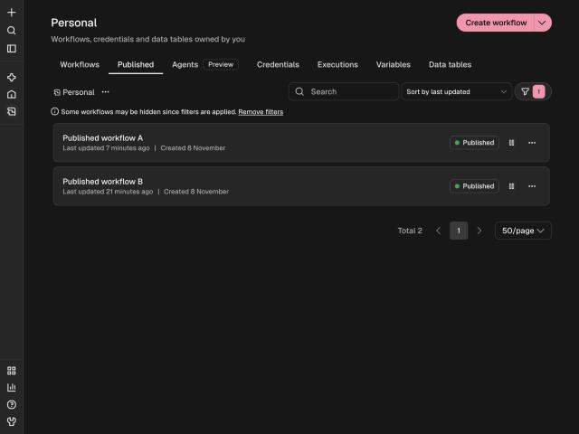
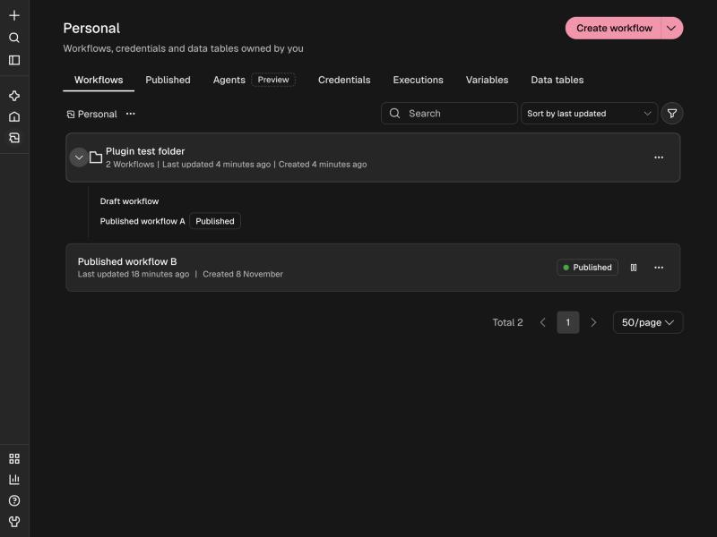
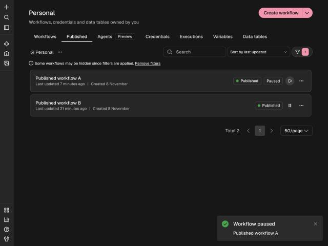
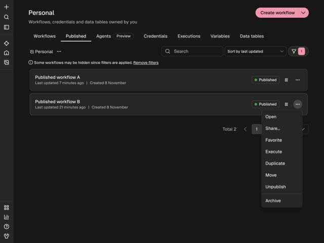
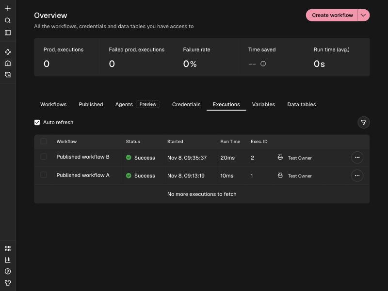
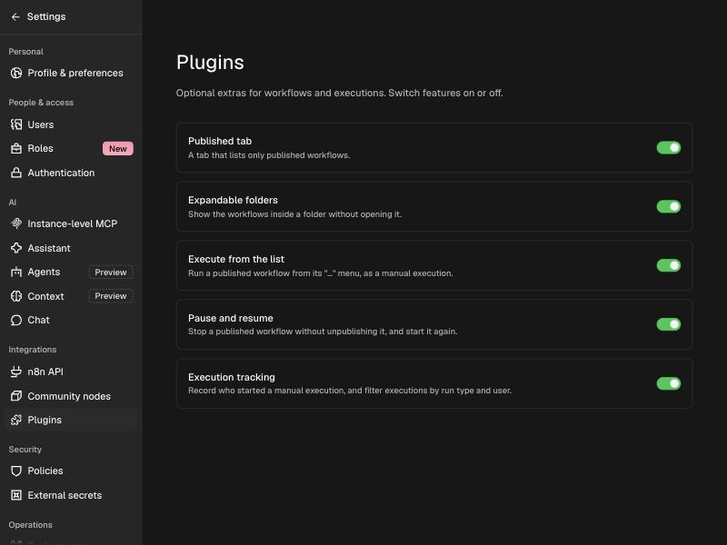
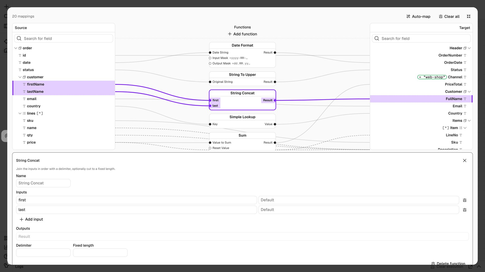
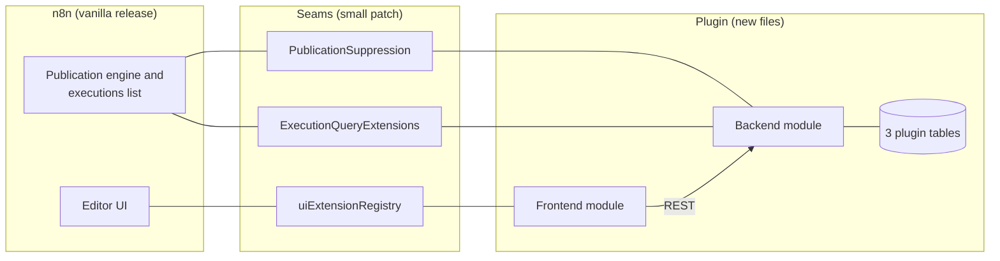
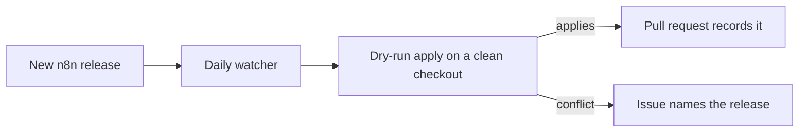

# n8n Extras Plugin

[](docs/compatibility.md)
[](docs/compatibility.md#database)
[](docs/updating.md)
[](LICENSE.md)

A plugin for [n8n](https://github.com/n8n-io/n8n) that adds a **Published tab**, **expandable folders**,
**pause and resume** for published workflows, **execute from the list**, and **run tracking with filters**
to the workflows and executions pages. It also adds a **Visual Data Mapper**: draw lines between source and
target fields, with functions in between. The mapper is a pure extension — it draws for the community node
[n8n-nodes-data-mapper](https://www.npmjs.com/package/n8n-nodes-data-mapper) when that node is installed, and
ships no node of its own.

> **Built to stay alongside n8n releases without impact.** The plugin adds its own code in new files,
> creates its own three database tables, **changes none of n8n's tables**, makes no outbound network
> calls, and every feature has an off switch. New n8n releases are checked automatically every day, and a
> conflict opens an issue instead of going unnoticed. See [compatibility](docs/compatibility.md) for
> exactly what it touches.

|  |  |
| --- | --- |
|  **Published tab** |  **Expandable folders** |
|  **Pause and resume** |  **Execute from the list** |
|  **Who ran it** |  **Settings > Integrations > Plugins** |

## Features

| Feature | What it does |
| --- | --- |
| **Published tab** | A tab between Workflows and Agents that lists only published workflows, including ones inside folders. |
| **Expandable folders** | A chevron on a folder card shows its workflows without opening it. Clicking the card still opens the folder. |
| **Execute from the list** | "Execute" in a published workflow's `...` menu runs the published version once, as a saved manual execution. |
| **Pause and resume** | A button on every published workflow stops its triggers and webhooks **without unpublishing**, and starts them again. |
| **Execution tracking** | Records who started a manual run, shows the name in the list, and adds **Run type** and **Run by** filters. |
| **Visual Data Mapper** | Map fields by drawing lines: a source tree, function boxes and a target tree. It draws for the installed community node [n8n-nodes-data-mapper](https://www.npmjs.com/package/n8n-nodes-data-mapper) and stores the map as that node's JSON definition. No node ships with the plugin. |



Each one can be switched off in **Settings > Integrations > Plugins**. Details and more screenshots are in
[features](docs/features.md).

## How it fits into n8n

n8n has no runtime plugin loader, so the plugin is an **overlay** on an n8n source checkout: new files, plus
a small patch that adds generic *seams* (extension points). The features live in a module that plugs into
the seams.



Read more in [architecture](docs/architecture.md).

## Quick start

**Just run it:** pull the prebuilt image — official n8n with the plugin baked in — and install the Data
Mapper node from the UI. No building. See [Unraid / Docker](docs/unraid.md).

```bash
docker run -it --rm -p 5678:5678 -v n8n_data:/home/node/.n8n \
  ghcr.io/silentjma/n8n-extras:latest
```

**Build from source** (for development, or your own registry):

```bash
git clone https://github.com/n8n-io/n8n.git && cd n8n
git checkout n8n@2.47.2

/path/to/n8n-extras-plugin/scripts/apply.sh . --check    # dry run
/path/to/n8n-extras-plugin/scripts/apply.sh .            # apply

pnpm install && pnpm build
```

Needs Node 24 or newer. Full instructions, the Visual Data Mapper and Docker notes are in
[installation](docs/installation.md).

## Automatic updates

A scheduled GitHub Actions workflow watches n8n's releases and records whether the plugin still applies.



To move your own checkout to a new release: `scripts/upgrade.sh /path/to/n8n n8n@<version>`. See
[updating](docs/updating.md).

### Verified n8n releases

| n8n release | Result |
| --- | --- |
| `2.47.2` | Applies cleanly |
| `2.47.0` | Applies cleanly |
| `2.46.6` | Older than the supported range |

The full, automatically updated table is in [compatibility](docs/compatibility.md).

## Documentation

| Page | Contents |
| --- | --- |
| [Features](docs/features.md) | Every feature with screenshots. |
| [Installation](docs/installation.md) | Apply, build, the community node, Docker, uninstall. |
| [Architecture](docs/architecture.md) | Seams, backend, frontend, data model, sequence diagrams. |
| [Compatibility](docs/compatibility.md) | What it touches, switching it off, tested releases. |
| [Unraid](docs/unraid.md) | Build the image, deploy on Unraid, install the Data Mapper node. |
| [Updating](docs/updating.md) | Release watching and upgrading. |
| [REST API](docs/api.md) | Endpoints and execution filters. |
| [Development](docs/development.md) | Layout, working loop, tests, rules for the seams. |
| [Troubleshooting](docs/troubleshooting.md) | Start-up errors and common symptoms. |

The same pages are available as a wiki. [AGENT.md](AGENT.md) has guidance for automated coding agents.

## Repository layout

```text
overlay/    new files, mirroring n8n's paths
patches/    core-seams.patch: the edits to existing n8n files
scripts/    apply, check, upgrade, watch, export, sync the mapper engine, build the image
compat/     releases.tsv and MIN_VERSION
docs/       documentation          wiki/   the same pages for the wiki
```

## Status

Built and tested on n8n `2.47.0` plus 39 commits; see [STATUS.md](STATUS.md) for what was verified
(including a browser pass) and what was not (Docker, PostgreSQL).

## License

The plugin follows n8n's [Sustainable Use License](https://github.com/n8n-io/n8n/blob/master/LICENSE.md).
See [LICENSE.md](LICENSE.md). The community node
[n8n-nodes-data-mapper](https://www.npmjs.com/package/n8n-nodes-data-mapper) is MIT and licensed in its own
repository. Not affiliated with n8n GmbH.
