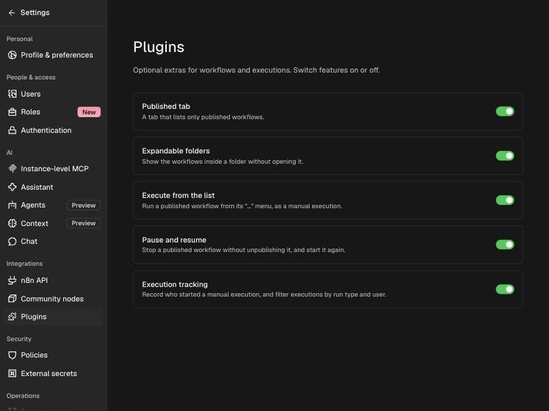
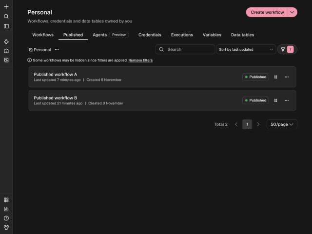
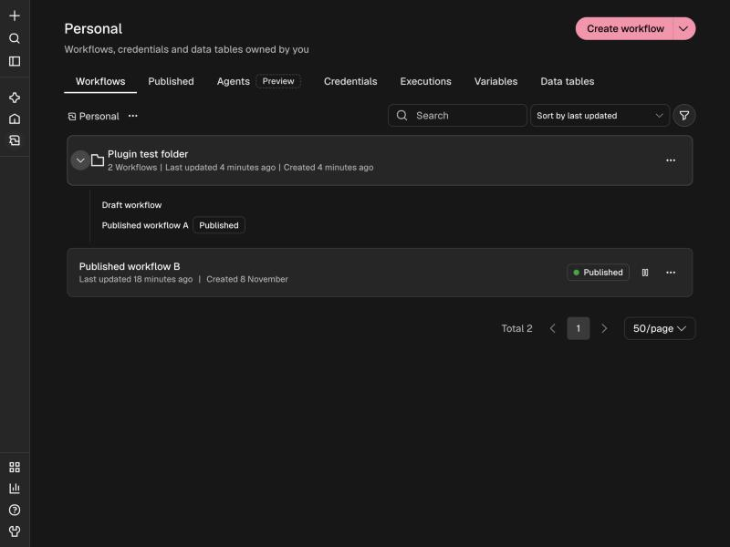
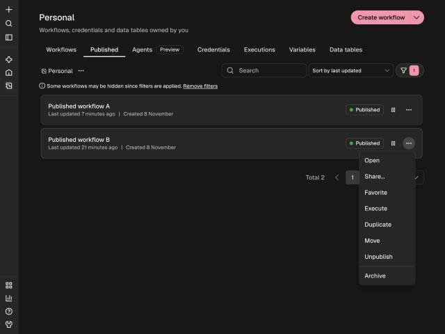
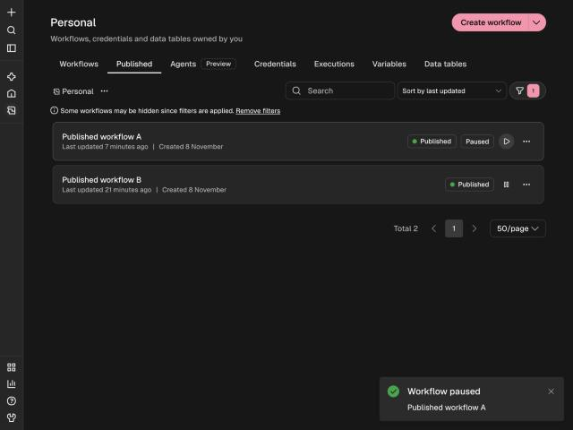
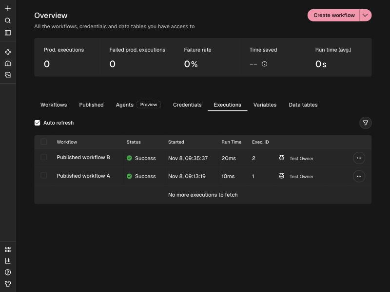
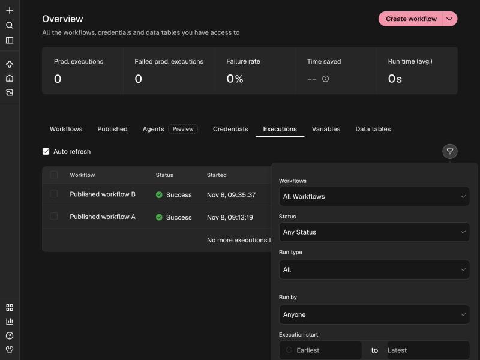
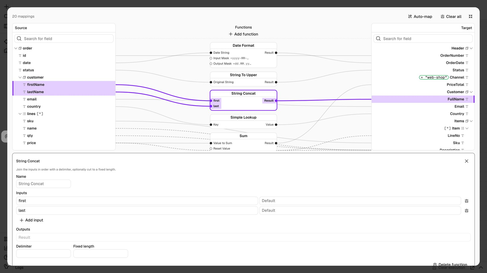

# Features

Every feature can be switched on or off in **Settings > Integrations > Plugins**. Only users who can
install community packages (instance admins) can change the switches.

| Switch | What it controls |
| --- | --- |
| Published tab | The Published tab on the workflows pages. |
| Expandable folders | The chevron on folder cards. |
| Execute from the list | "Execute" in a workflow's `...` menu. |
| Pause and resume | The pause and resume button and the Paused badge. |
| Execution tracking | Recording who started a manual run, the name in the list, and the two filters. |
| Visual Data Mapper | The visual mapper for the community node's Data Mapper. When off, the map is edited as JSON. |

## Published tab

A tab between **Workflows** and **Agents** that lists only published workflows. It works on the Overview,
on project pages and on "Shared with you". It is the normal workflows list with the status filter set to
Published, so search, sorting and paging all behave as usual.

On a project page the tab also lists published workflows that sit inside folders.

## Expandable folders

A chevron at the start of a folder card shows the workflows directly inside the folder, without opening
it. Clicking the card itself still opens the folder. Published workflows carry a Published badge. When the
Published tab is active, only published workflows are shown.

Folders need n8n's folders feature, which depends on your n8n license.

## Execute from the list

Open the `...` menu of a published workflow and choose **Execute**. It runs the **published** version once,
as a manual execution, starting from a trigger that can fire without an outside call (the Manual Trigger
first, then for example a Schedule Trigger). The run is always saved, so it appears on the Executions page.

A workflow whose only trigger is a webhook cannot be started this way and returns a clear error. Open it
in the editor to run it.

## Pause and resume

A button on every published workflow stops its triggers and webhooks **without unpublishing it**. The
workflow keeps its published version, so resuming starts the same triggers again with no new publish.

- Pausing needs the unpublish permission; resuming needs the publish permission.
- A paused workflow stays paused across restarts.
- While paused, its production webhook URLs stop responding and its schedule does not fire.

## Execution tracking

Manual executions record who started them. This covers runs from the editor and runs started with
**Execute**. The Executions page shows the user's name next to the manual-run icon, and the filter panel
gains two fields:

- **Run type**: All, Manual or Automatic.
- **Run by**: Anyone, or a specific user.

Executions from before the plugin was installed show no user.

## Visual Data Mapper

This is a pure extension: it adds the visual editor to the community node
[n8n-nodes-data-mapper](https://www.npmjs.com/package/n8n-nodes-data-mapper). Install that node from npm
(the plugin ships no node of its own); the plugin detects it and draws the mapper for its **Visual Mapping**
field. With the node installed but the plugin off, the same field is plain JSON, so nothing breaks.

In the node, set **Define Mappings** to **Visual Mapper**. Paste a **Target Profile**
(sample JSON or XML, JSON Schema, XSD, CSV header) and optionally a **Source Profile**. Without a source
profile, the first input item is the source structure (run the previous node first).

- Drag a source field onto a target field to map it.
- **Add function** adds a function box: String, Numeric (exact decimals, Sum, Count, counters), Date,
  Language, Simple Lookup and User-Defined chains. Drag source fields onto its inputs and its outputs onto
  target fields. A function never feeds another function directly.
- The pencil on a target field sets a fixed value. **Auto-map** maps fields with similar names.
- Select a line, a field or a function to edit it. Its fields, ports and lines turn purple and the other
  lines fade.

The map is stored in the node as a JSON definition (`{ "mappings": [...], "functions": [...] }`), the same
format as **Define Mappings > Using JSON**. It runs the same with the module or the switch off; then the
node shows the definition as JSON. The node does the mapping at run time, so a workflow built with the
visual editor runs on any n8n that has the community node, with or without this plugin.
