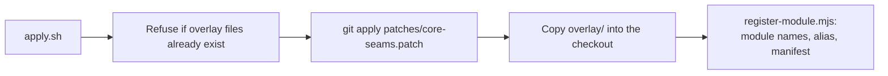

# Installation

The plugin is applied to a **source checkout** of n8n and built with it. There is no separate package
to install.

## Requirements

- A git checkout of [n8n](https://github.com/n8n-io/n8n) at a supported version (see
  [compatibility](compatibility.md)).
- Node.js 24 or newer and pnpm, the same tools n8n itself needs to build.
- `git` and `node` on the path.

## Install

```bash
# 1. Get n8n at a supported release
git clone https://github.com/n8n-io/n8n.git && cd n8n
git checkout n8n@2.47.2

# 2. Check that the plugin applies (changes nothing)
/path/to/n8n-extras-plugin/scripts/apply.sh . --check

# 3. Apply it
/path/to/n8n-extras-plugin/scripts/apply.sh .

# 4. Build as you normally would
pnpm install
pnpm build
```

What `apply.sh` does:



The backend module `extras` is on by default once built. Start n8n as usual; the first start runs the
plugin's migration.

## Optional: the two nodes

```bash
/path/to/n8n-extras-plugin/scripts/build-nodes.sh .
N8N_CUSTOM_EXTENSIONS=/path/to/n8n-extras-plugin/nodes/dist pnpm start
```

The nodes are custom nodes loaded from a folder, so no n8n file is touched for them. To check them:
`scripts/test-nodes.sh .`.

## Docker

n8n builds its own image from a checkout with `pnpm build:docker`. Apply the plugin first and build the
image from the patched checkout. `docker/Dockerfile.extras` adds the two nodes on top of that image. It
has **not been built or tested**; treat it as a starting point.

## Check that it works

1. Sign in and open the workflows page: a **Published** tab sits between Workflows and Agents.
2. Open **Settings > Integrations > Plugins**: five switches.
3. `GET /rest/extras/state` (signed in) returns the features and an empty `pausedWorkflowIds`.

## Uninstall

1. Check out a clean copy of n8n (or `git checkout -- .` and remove the new files in
   [architecture](architecture.md)), then rebuild.
2. Optionally drop the tables `extras_workflow_pause`, `extras_execution_actor` and `extras_setting`.

To keep the plugin built in but inactive, set `N8N_DISABLED_MODULES=extras`.
