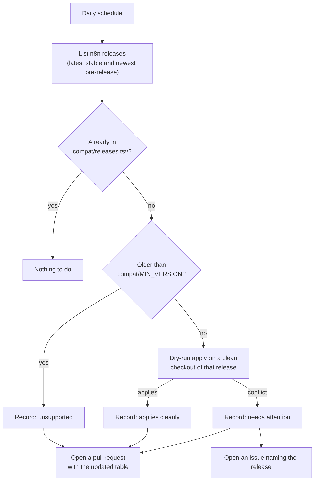

# Updating

When n8n ships a new release you want two answers: *does the plugin still apply?* and *how do I move
my checkout?* This repository answers the first one automatically.

## Automatic release watching

A GitHub Actions workflow, `.github/workflows/upstream-watch.yml`, runs once a day.



- The result of every check is recorded in [`compat/releases.tsv`](../compat/releases.tsv) and shown in
  the table in [compatibility](compatibility.md).
- If a release **applies cleanly**, you get a pull request that records it. Merge it, or ignore it.
- If a release **conflicts**, you get an issue that names it, so a breaking release never goes unnoticed.
- It is a dry run of the patch and the module registration. It does not build or test that release.

The workflow uses only the repository's own token. If pull requests from Actions are blocked by your
repository settings, enable *Settings > Actions > General > Allow GitHub Actions to create and approve
pull requests*.

You can run the same check by hand:

```bash
scripts/watch-upstream.sh --dry-run     # report only, change nothing
scripts/check-upstream.sh n8n@2.47.2    # one specific release
```

## Moving a checkout to a new release

```bash
scripts/upgrade.sh /path/to/n8n n8n@2.47.3
cd /path/to/n8n && pnpm install && pnpm build
```

`upgrade.sh` removes the plugin from the working tree, moves n8n to the tag, checks that the plugin
applies, and applies it again. It refuses a checkout with other uncommitted changes and commits nothing.

## When a release does not apply

The patch is the only part that can conflict, and each hunk is a small generic seam. The error names the
file. Then:

1. Apply the plugin to the *previous* release so you have a working tree.
2. Move the failing hunk to the new release's code by hand.
3. Regenerate the patch with `scripts/export-from-fork.sh <patched-n8n-dir> <vanilla-commit>`.
4. Run the [tests](development.md#tests) and add the release to `compat/releases.tsv`.

If `register-module.mjs` reports a missing anchor, update that anchor in the script; it names the file.
