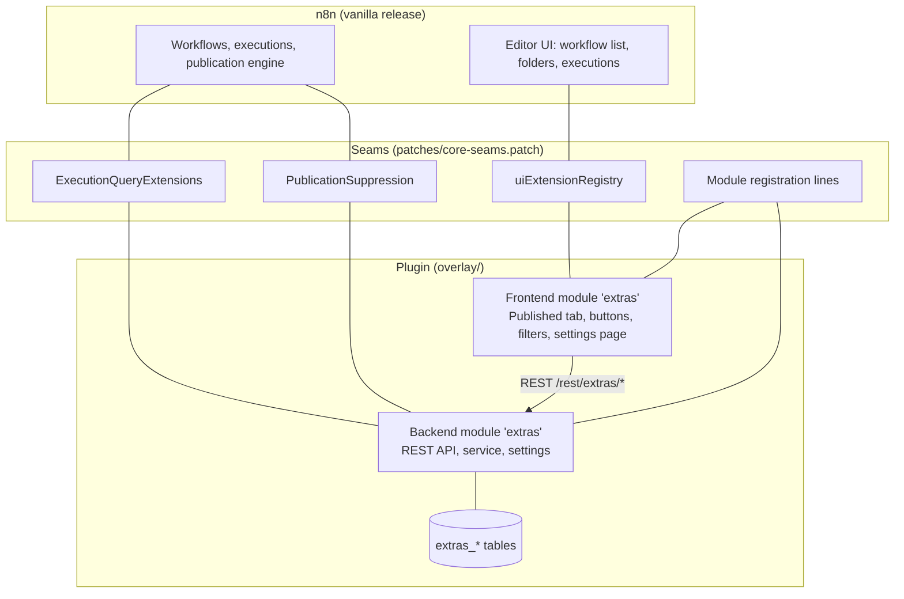
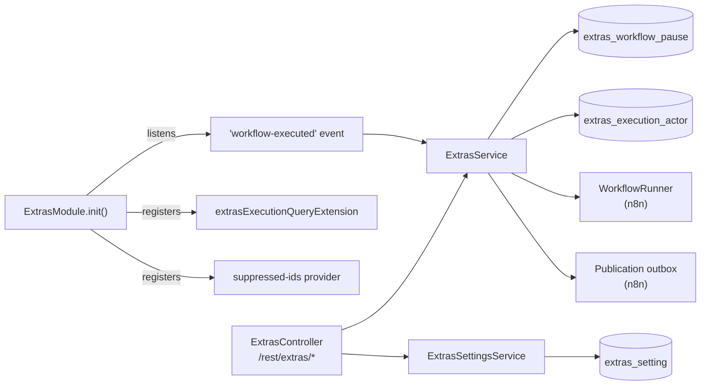
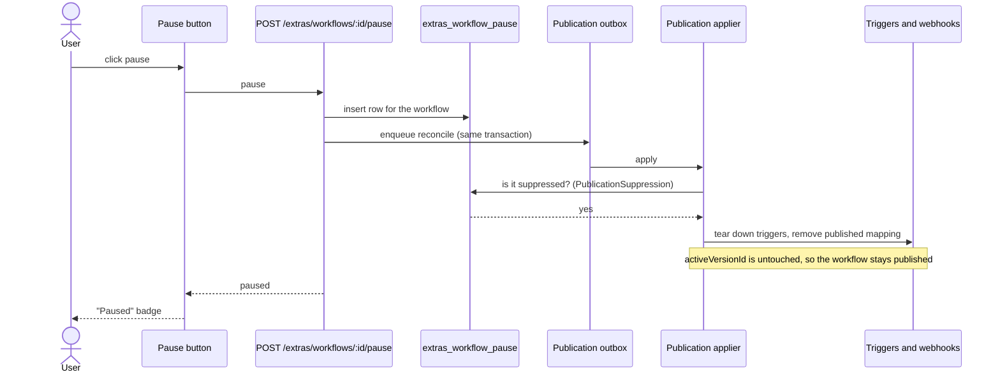
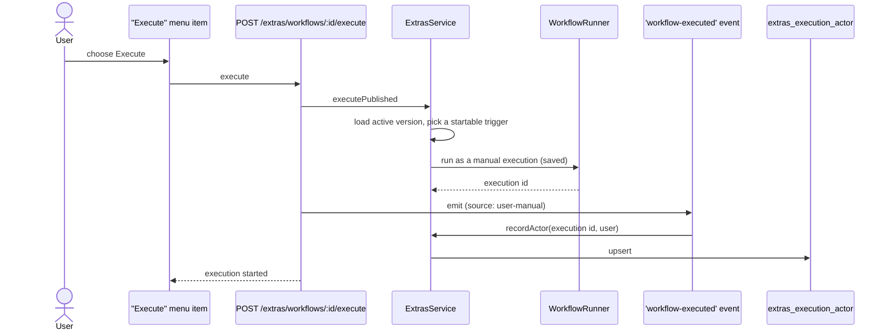
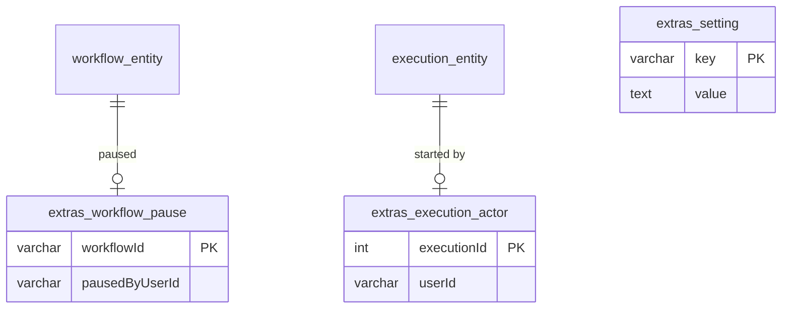
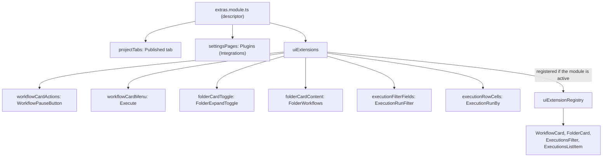

# Architecture

The plugin is an **overlay** on a vanilla n8n checkout. n8n has no runtime plugin loader (its
"modules" are compiled into the app), so the plugin is built from two parts:

1. **New files** that only add code (`overlay/`), including a backend module and a frontend module.
2. **A small patch** (`patches/core-seams.patch`) that adds *seams*: generic extension points in
   n8n's existing files so a module can plug in without n8n knowing anything about it.

## Why seams instead of editing n8n directly

| Approach | Result |
| --- | --- |
| Edit n8n's files to add each feature | Every n8n release risks a merge conflict in logic you do not own. |
| **Add generic seams once, put the features in a module** | The patch is small and stable. The features live in new files that n8n never touches. |

Each seam is generic: it does not mention any feature of the plugin.

## The seams

| Seam | Where | What it lets a module do |
| --- | --- | --- |
| `PublicationSuppression` | `packages/cli/src/workflows/publication/` | Keep a *published* workflow's triggers and webhooks switched off without unpublishing it. Read by the publication applier, the reconciler and startup activation. |
| `ExecutionQueryExtensions` | `packages/@n8n/db/src/repositories/` | Add filters (through the single `ext` filter key) and extra fields (`ext` on each summary) to the executions list. |
| `uiExtensionRegistry` | `@n8n/frontend-module-sdk` | Contribute components to the workflow card, folder card, executions filter and executions row. Filled at startup for active modules only. |
| Tab options `isActive` and `dynamicRoute.query` | `@n8n/frontend-module-sdk` | A module tab that shares a route with another tab and differs by query string (the Published tab). |
| Module registration | `module-registry.ts`, `modules.config.ts`, `modules.manifest.ts`, vite alias, tsconfig paths | Name the `extras` module so n8n loads it. These are the same lines n8n's own module scaffolder writes. |

Two small behaviours also change in the workflow list itself, whether or not the module is active.
See [compatibility](Compatibility#what-changes-even-when-the-module-is-off).

## Backend

The backend is a regular n8n backend module, `packages/cli/src/modules/extras/`.

### Pause and resume

Pausing never changes the workflow's publication. It records the pause in the plugin's own table and
asks n8n's publication engine to reconcile.

Resume deletes the row and enqueues the same reconcile. The applier then sees an unsuppressed workflow
and registers its triggers again from the active version.

### Execute from the list and run tracking

Manual runs from the editor emit the same event, so they are tracked too. The executions list then
asks `ExecutionQueryExtensions` to enrich each summary with `ext.executedByUserId` and to apply the
`manualExecution` and `executedByUserId` filters.

### Data model

The plugin owns three tables and never alters an n8n table.

Both foreign keys cascade on delete, so removing a workflow or an execution cleans up its rows.

## Frontend

The frontend is a regular n8n frontend module, `packages/modules/extras/frontend/`, declared in a
descriptor. The shell reads it at startup.

A module that is not active contributes nothing, so the shell components render exactly as they do in
vanilla n8n.

## The nodes

Data Mapper and Message Template are **custom nodes**, built from `nodes/` and loaded through n8n's
`N8N_CUSTOM_EXTENSIONS` setting. They are independent of the module and of the patch.
