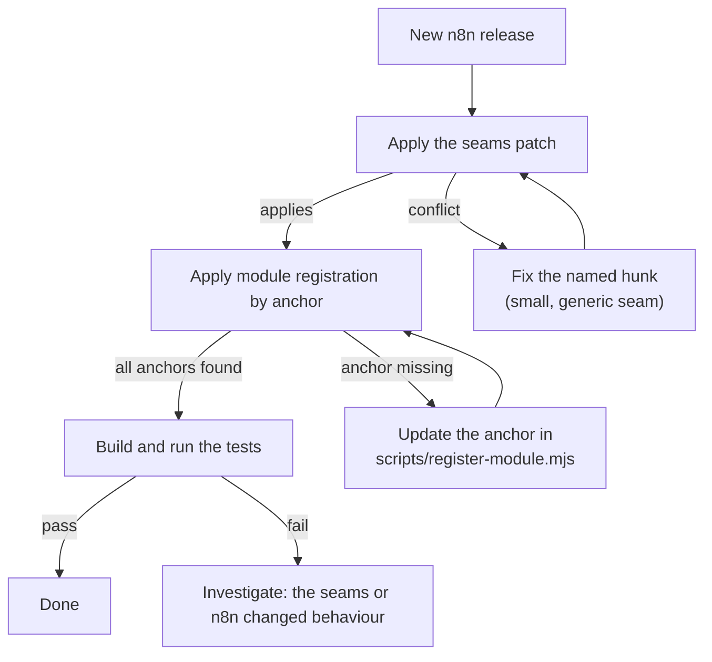

# Compatibility and impact

> **The plugin is designed to sit alongside n8n releases without affecting them.** It adds code in new
> files, owns its own database tables, can be switched off feature by feature or as a whole, and makes
> no outbound network calls. This page says exactly what it touches, so you can judge the impact
> yourself.

## What is added and what is edited

| | Count | Notes |
| --- | --- | --- |
| New files | about 46 | Backend module, frontend module, one migration, the seam registries, tests. Nothing in n8n is overwritten. |
| Existing n8n files edited | 29 | Small, generic seams plus tests. See [architecture](Architecture#the-seams). |
| Lines of registration added by script | 7 files | Module names, alias, manifest. Written by `scripts/register-module.mjs`, by anchor. |
| n8n database tables altered | **0** | The plugin creates three of its own tables. |
| Outbound network calls | **0** | Everything is n8n's own REST API on the same instance. |

## Database

The plugin adds one migration that creates `extras_workflow_pause`, `extras_execution_actor` and
`extras_setting`. It does not add a column to, or change, any n8n table.

- Deleting a workflow or an execution removes its plugin rows (cascading foreign keys).
- To remove the plugin completely, drop the three tables. Nothing else in the database refers to them.

## Switching it off

| Level | How | Effect |
| --- | --- | --- |
| One feature | Settings > Integrations > Plugins | The feature's UI and endpoint behaviour stop. Other features keep working. |
| The whole module | Set `N8N_DISABLED_MODULES=extras` | The backend module does not load and the UI contributes nothing. The tables stay, unused. |

With the module disabled, the seams have no provider registered, so n8n behaves as it does without the
plugin, apart from the two list behaviours below.

## What changes even when the module is off

Two small behaviours of the workflow list were changed in n8n's own view, because the Published tab needs
them:

1. **The list follows a status change in the URL.** Moving between `/workflows` and
   `/workflows?status=true` while the page is open now re-filters the list. Before, only a full page load
   did.
2. **A status filter searches across folders.** On a project page, filtering by status (for example
   "Published") now looks inside folders, the same way filtering by tag already does. Before, it listed
   only the top level.

Both are covered by tests in `WorkflowsView.test.ts`.

## Verified against n8n releases

The table below is updated automatically (see [updating](Updating)). "Applies cleanly" means the
patch and the module registration were applied to a clean checkout of that release without conflicts.
It is a dry run, not a full build and test of that release.

<!-- compat:start -->
| n8n release | Result | Checked |
| --- | --- | --- |
| `n8n@2.47.2` | Applies cleanly | 2026-11-08 |
| `n8n@2.47.0` | Applies cleanly | 2026-11-08 |
| `n8n@2.46.6` | Older than the supported range | 2026-11-08 |
<!-- compat:end -->

The plugin was built and fully tested (build, typecheck, unit and integration tests, and a browser pass)
on n8n `2.47.0` plus 39 commits (`3895cb31`). Releases older than the version in
[`compat/MIN_VERSION`](https://github.com/SilentJMA/n8n-extras-plugin/blob/main/compat/MIN_VERSION) are not supported.

## What to expect on a new n8n release

If your n8n version is newer than the ones listed and you need it today, run
`scripts/check-upstream.sh <tag>` for a dry run before you upgrade.

## Known limits

- **Folders.** Expandable folders need n8n's folders feature, which depends on your n8n license.
- **Publishing.** n8n only lets you publish a workflow that has a real trigger, so "published" workflows
  always have one.
- **Execute from the list** starts a trigger that can fire without an outside call (Manual Trigger first,
  then for example Schedule). A workflow whose only trigger is a webhook returns a clear error.
- **Languages.** Plugin text is English only; n8n does not read module translations yet.
- **Existing executions** from before the plugin was installed show no "run by" user.
- **Database.** Tested on SQLite. The migration uses n8n's schema builder, but was not run on PostgreSQL.
