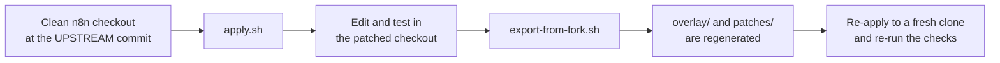

# Development

## Repository layout

```text
n8n-extras-plugin/
├── overlay/              New files, copied into an n8n checkout (mirrors n8n's own paths)
├── patches/
│   └── core-seams.patch  Edits to existing n8n files: the generic seams
├── scripts/              apply, check, upgrade, watch, export, sync-data-mapper-engine, build-image
├── compat/               releases.tsv (check results) and MIN_VERSION
├── docs/                 This documentation
├── wiki/                 The same pages, shaped for the GitHub wiki
├── UPSTREAM              The n8n commit the plugin was built and tested against
└── AGENT.md              Guidance for automated coding agents
```

`overlay/` and `patches/` are generated, not edited by hand. You work in a patched n8n checkout and
export.

## Working loop



```bash
scripts/apply.sh ~/n8n                                   # patched checkout to work in
# ... change code in ~/n8n ...
scripts/export-from-fork.sh ~/n8n <base-commit>          # regenerate overlay/ and the patch
```

The base commit is in `UPSTREAM`. Always verify an export by applying it to a fresh clone of the base
commit (`scripts/apply.sh <fresh-clone> --check`).

## Where the code lives

| Part | Path (in an n8n checkout) |
| --- | --- |
| Backend module | `packages/cli/src/modules/extras/` |
| Seam: publication | `packages/cli/src/workflows/publication/publication-suppression.ts` |
| Seam: execution queries | `packages/@n8n/db/src/repositories/execution-query-extensions.ts` |
| Migration | `packages/@n8n/db/src/migrations/common/1793700100000-CreateExtrasTables.ts` |
| Frontend module | `packages/modules/extras/frontend/` |
| Seam: UI registry and types | `packages/frontend/@n8n/frontend-module-sdk/src/` |
| Backend tests | `packages/cli/test/integration/extras/` |

## Tests

Run from the patched n8n checkout.

```bash
# Backend module (API, database, filters)
cd packages/cli
N8N_LOG_LEVEL=silent DB_TYPE=sqlite pnpm exec vitest run -c vitest.config.integration.ts test/integration/extras

# Frontend module and the UI seams
cd packages/modules/extras/frontend && pnpm exec vitest run
cd packages/frontend/@n8n/frontend-module-sdk && pnpm exec vitest run
cd packages/frontend/editor-ui && pnpm vitest run \
  src/app/components/WorkflowCard.test.ts \
  src/app/views/WorkflowsView.test.ts \
  src/features/core/folders \
  src/features/collaboration/projects/components \
  src/features/execution

# Type checks
cd packages/cli && pnpm exec tsc --noEmit -p tsconfig.json
cd packages/frontend/editor-ui && pnpm typecheck
```

The Visual Data Mapper draws for the community node
[n8n-nodes-data-mapper](https://www.npmjs.com/package/n8n-nodes-data-mapper); the plugin ships no node. After
changing the node's engine in its own repository, pull the copy the editor preview uses into the module with
`scripts/sync-data-mapper-engine.sh ~/n8n [community-node-dir]`, then re-export. The node's own tests live in
the community node repository.

Two notes from experience:

- Run the editor UI tests once before trusting a failure. On a cold first run a few tests can hit the
  default 5 second timeout.
- A unit test that stubs a component cannot catch a wrong route name or a mis-wired import. After a UI
  change, look at it in a browser (see [troubleshooting](Troubleshooting#the-ui-does-not-show-my-change)).

## Rules for changing the seams

1. Keep every seam generic. It must not mention a feature of the plugin.
2. Prefer adding a new file over editing an existing n8n file.
3. If you must edit an existing file, keep the edit small and add a test for it.
4. Module registration goes in `scripts/register-module.mjs`, by anchor, not in the patch.
5. Never change an n8n table. Add plugin tables with a new migration.
