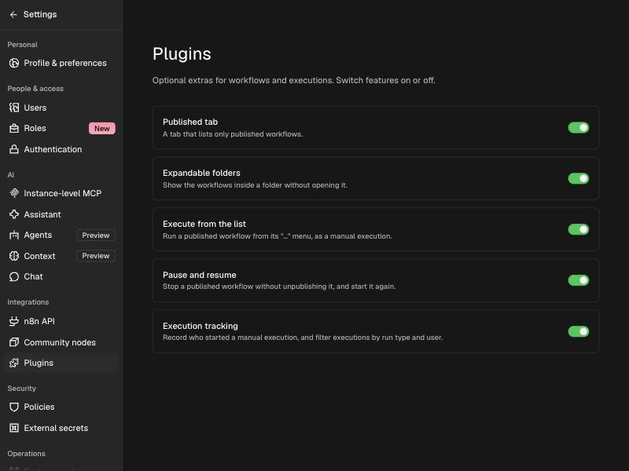
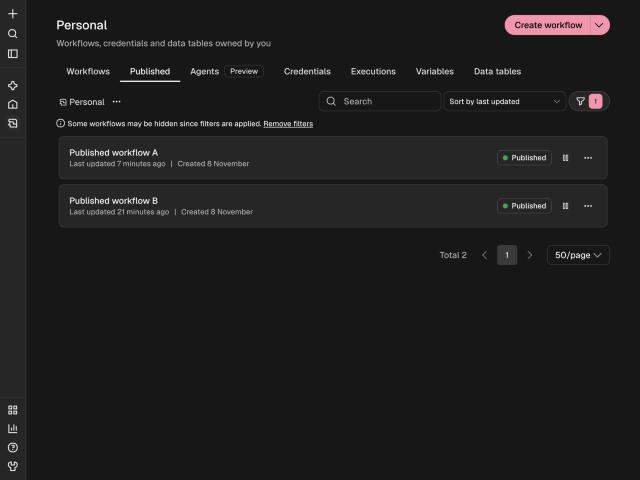
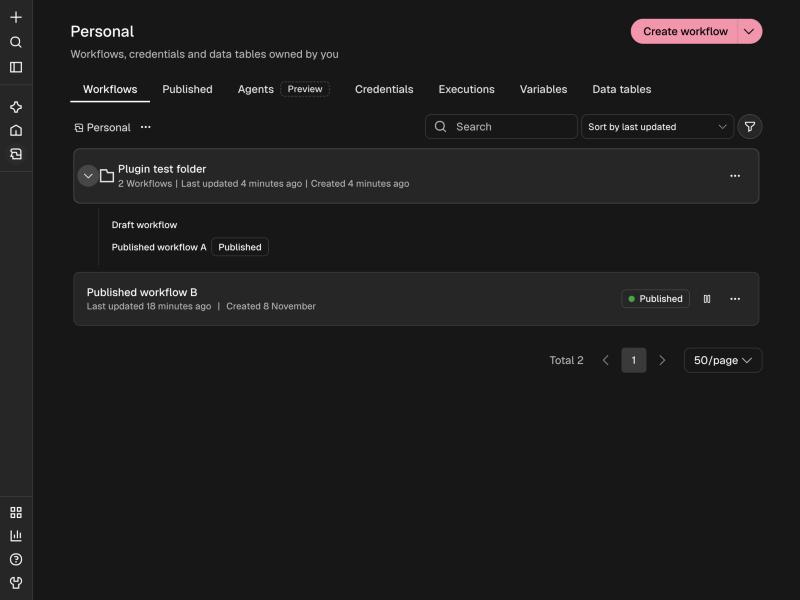
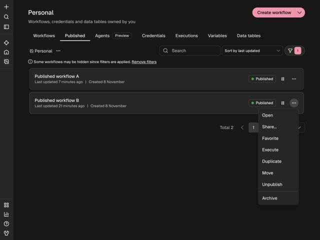
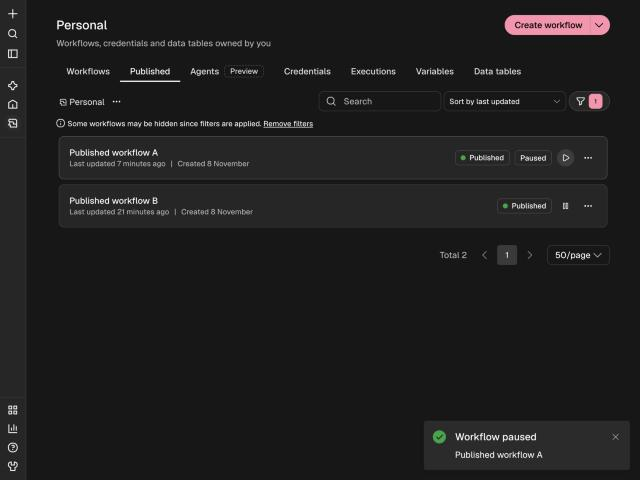
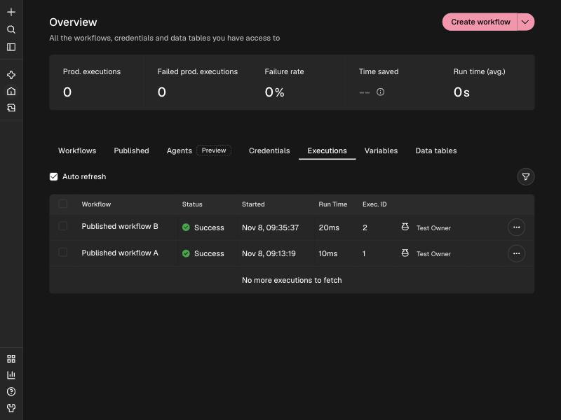
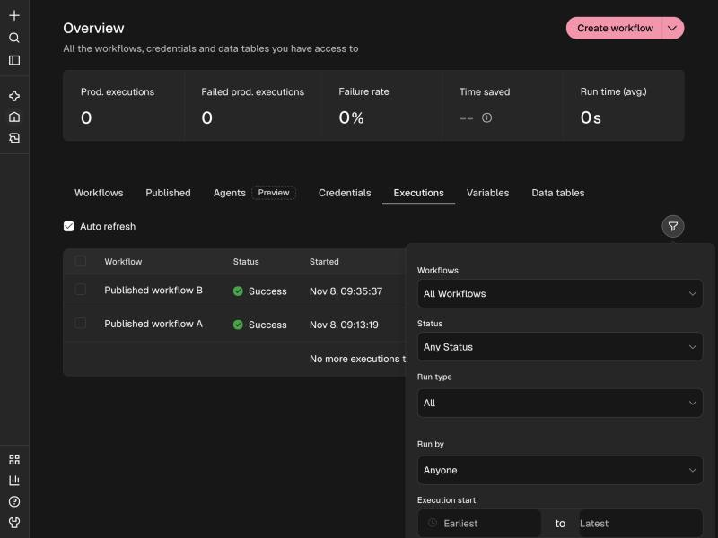

# Features

Every feature can be switched on or off in **Settings > Integrations > Plugins**. Only users who can
install community packages (instance admins) can change the switches.

| Switch | What it controls |
| --- | --- |
| Published tab | The Published tab on the workflows pages. |
| Expandable folders | The chevron on folder cards. |
| Execute from the list | "Execute" in a workflow's `...` menu. |
| Pause and resume | The pause and resume button and the Paused badge. |
| Execution tracking | Recording who started a manual run, the name in the list, and the two filters. |

## Published tab

A tab between **Workflows** and **Agents** that lists only published workflows. It works on the Overview,
on project pages and on "Shared with you". It is the normal workflows list with the status filter set to
Published, so search, sorting and paging all behave as usual.

On a project page the tab also lists published workflows that sit inside folders.

## Expandable folders

A chevron at the start of a folder card shows the workflows directly inside the folder, without opening
it. Clicking the card itself still opens the folder. Published workflows carry a Published badge. When the
Published tab is active, only published workflows are shown.

Folders need n8n's folders feature, which depends on your n8n license.

## Execute from the list

Open the `...` menu of a published workflow and choose **Execute**. It runs the **published** version once,
as a manual execution, starting from a trigger that can fire without an outside call (the Manual Trigger
first, then for example a Schedule Trigger). The run is always saved, so it appears on the Executions page.

A workflow whose only trigger is a webhook cannot be started this way and returns a clear error. Open it
in the editor to run it.

## Pause and resume

A button on every published workflow stops its triggers and webhooks **without unpublishing it**. The
workflow keeps its published version, so resuming starts the same triggers again with no new publish.

- Pausing needs the unpublish permission; resuming needs the publish permission.
- A paused workflow stays paused across restarts.
- While paused, its production webhook URLs stop responding and its schedule does not fire.

## Execution tracking

Manual executions record who started them. This covers runs from the editor and runs started with
**Execute**. The Executions page shows the user's name next to the manual-run icon, and the filter panel
gains two fields:

- **Run type**: All, Manual or Automatic.
- **Run by**: Anyone, or a specific user.

Executions from before the plugin was installed show no user.

## Data Mapper and Message Template nodes

Two custom nodes that load alongside n8n's own: **Data Mapper** maps and transforms data between
structures (JSON, XML, CSV, lookup tables, array wildcards) and **Message Template** renders text, JSON,
XML or files from an expression template. See [installation](Installation#optional-the-two-nodes).
