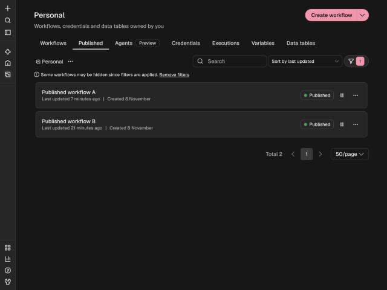

# n8n Extras Plugin

A plugin for [n8n](https://github.com/n8n-io/n8n) that adds a **Published tab**, **expandable folders**,
**pause and resume** for published workflows, **execute from the list**, **run tracking with filters**,
and a **Visual Data Mapper** for the community node [n8n-nodes-data-mapper](https://www.npmjs.com/package/n8n-nodes-data-mapper).

> **Built to stay alongside n8n releases without impact.** It adds its own code in new files, creates its
> own three database tables, changes none of n8n's tables, makes no outbound network calls, and every
> feature has an off switch. New n8n releases are checked automatically every day. See
> [Compatibility](Compatibility).

## Pages

| Page | Contents |
| --- | --- |
| [Features](Features) | Every feature with screenshots. |
| [Installation](Installation) | Apply, build, the community node, Docker, uninstall. |
| [Architecture](Architecture) | The seams, the modules, the data model, sequence diagrams. |
| [Compatibility](Compatibility) | What it touches, switching it off, tested releases. |
| [Unraid](Unraid) | Build the image, deploy on Unraid, install the Data Mapper node. |
| [Updating](Updating) | Automatic release watching and upgrading. |
| [REST-API](REST-API) | Endpoints and execution filters. |
| [Development](Development) | Layout, working loop, tests, rules for the seams. |
| [Troubleshooting](Troubleshooting) | Start-up errors and common symptoms. |

The source of these pages is the `docs/` folder of the [repository](https://github.com/SilentJMA/n8n-extras-plugin); the wiki
is generated from it.
