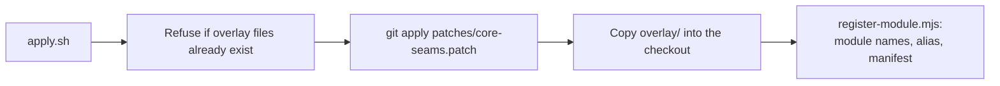

# Installation

The plugin is applied to a **source checkout** of n8n and built with it. There is no separate package
to install.

## Requirements

- A git checkout of [n8n](https://github.com/n8n-io/n8n) at a supported version (see
  [compatibility](Compatibility)).
- Node.js 24 or newer and pnpm, the same tools n8n itself needs to build.
- `git` and `node` on the path.

## Install

```bash
# 1. Get n8n at a supported release
git clone https://github.com/n8n-io/n8n.git && cd n8n
git checkout n8n@2.47.2

# 2. Check that the plugin applies (changes nothing)
/path/to/n8n-extras-plugin/scripts/apply.sh . --check

# 3. Apply it
/path/to/n8n-extras-plugin/scripts/apply.sh .

# 4. Build as you normally would
pnpm install
pnpm build
```

What `apply.sh` does:



The backend module `extras` is on by default once built. Start n8n as usual; the first start runs the
plugin's migration.

## The Visual Data Mapper node

The plugin ships **no node**. The Visual Data Mapper draws for the community node
[n8n-nodes-data-mapper](https://www.npmjs.com/package/n8n-nodes-data-mapper), installed the usual way
(**Settings > Community nodes**, or `npm install n8n-nodes-data-mapper` in the n8n data folder). The plugin
detects it automatically: with the module active, add a **Data Mapper** node and set **Define Mappings** to
**Visual Mapper**. With the plugin off, the same field is plain JSON, so the node keeps working.

The map is stored as the node's own JSON definition, so a workflow built with the visual editor runs on any
n8n that has the community node. When you change the node's engine in its repository, run
`scripts/sync-data-mapper-engine.sh <n8n-dir> [community-node-dir]` so the editor preview uses the same
engine, then export.

## Docker

The easy way is the **prebuilt image** `ghcr.io/silentjma/n8n-extras:latest` — official n8n with the plugin
baked in. Pull it, mount a data volume, and install the community node from the UI. See [Unraid](Unraid),
which applies to any Docker host.

To build it yourself, `scripts/build-image.sh <n8n-dir> [image:tag]` applies the overlay and runs n8n's own
`pnpm build:docker`, so the module is part of the image. Either way the image does not ship the Data Mapper
node; install the community node `n8n-nodes-data-mapper` from **Settings > Community nodes** in the running
instance, so it lives in the data volume.

## Check that it works

1. Sign in and open the workflows page: a **Published** tab sits between Workflows and Agents.
2. Open **Settings > Integrations > Plugins**: five switches.
3. `GET /rest/extras/state` (signed in) returns the features and an empty `pausedWorkflowIds`.

## Uninstall

1. Check out a clean copy of n8n (or `git checkout -- .` and remove the new files in
   [architecture](Architecture)), then rebuild.
2. Optionally drop the tables `extras_workflow_pause`, `extras_execution_actor` and `extras_setting`.

To keep the plugin built in but inactive, set `N8N_DISABLED_MODULES=extras`.
